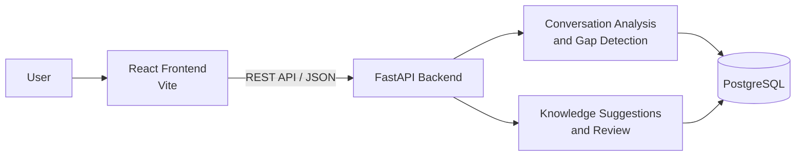
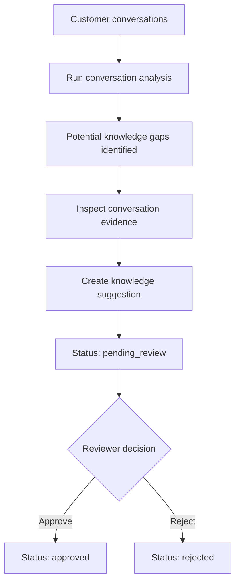
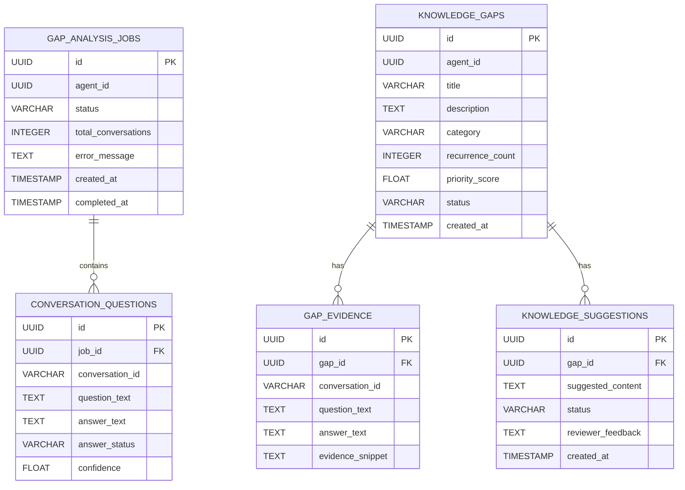

<div align="center">

# 🔍 Bolna Knowledge Gap Miner

**Identify knowledge gaps. Improve AI agent responses. Build better customer experiences.**

A FastAPI + React application that analyzes customer conversations to surface potential knowledge gaps in AI voice agents, then routes proposed answers through a human review workflow.


</div>

---

## 📖 Table of Contents

- [Introduction](#-introduction)
- [Key Features](#-key-features)
- [Demo](#-demo)
- [System Architecture](#️-system-architecture)
- [Technology Stack](#-technology-stack)
- [Application Workflow](#-application-workflow)
- [Project Structure](#-project-structure)
- [Installation and Setup](#️-installation-and-setup)
- [Environment Variables](#-environment-variables)
- [API Documentation](#-api-documentation)
- [Database Design](#️-database-design)
- [Screenshots](#️-screenshots)
- [Testing](#-testing)
- [Deployment](#-deployment)
- [Future Improvements](#️-future-improvements)
- [Author](#-author)
- [Disclaimer](#️-disclaimer)

---

## 🎯 Introduction

AI voice agents regularly encounter customer questions their knowledge base does not cover. These gaps can lead to unanswered questions, inconsistent responses, and a poor customer experience. The evidence often remains buried in conversation logs.

**Bolna Knowledge Gap Miner** turns conversation data into actionable knowledge improvements. It helps teams:

- Detect recurring questions an agent may struggle to answer.
- Inspect conversation evidence behind each potential gap.
- Draft proposed knowledge answers.
- Review, approve, or reject proposals before any knowledge is published.

## ✨ Key Features

| Feature | Description |
|---|---|
| **Knowledge gap detection** | Surfaces potential knowledge gaps and recurring customer questions associated with an agent. |
| **Conversation evidence** | Presents customer questions and agent responses to help reviewers understand the context. |
| **Knowledge suggestions** | Create a proposed answer for a specific knowledge gap. |
| **Review workflow** | Proposals move through `pending_review`, `approved`, and `rejected` statuses. |
| **Dashboard** | Browse knowledge gaps, inspect evidence, and review proposals through a React interface. |

> The implementation details of the conversation ingestion and gap-detection process should be verified from the source code before describing the detection algorithm.

## 🎬 Demo

| Resource | Link |
|---|---|
| 🌐 **Live application** | `PLACEHOLDER: deployed application URL` |
| 🎥 **Demo video** | `PLACEHOLDER: Loom video URL` |
| 🖼️ **Screenshots** | See the [Screenshots](#️-screenshots) section |

## 🏗️ System Architecture



### Components

- **Frontend:** React single-page application built with Vite. It lets users browse knowledge gaps, inspect evidence, and review proposals.
- **Backend:** FastAPI service exposing REST endpoints for gap retrieval, suggestion creation, suggestion listing, and review. Route modules are located in `app/api/routes/`.
- **Database:** PostgreSQL accessed through SQLAlchemy async operations.
- **API validation:** Pydantic schemas structure and validate API requests and responses.
- **Interaction:** The frontend communicates with the backend over HTTP. The backend reads and writes application state in PostgreSQL.

## 🧰 Technology Stack

### Backend
- Python 3.12+
- FastAPI
- SQLAlchemy (async)
- Pydantic

### Frontend
- React
- Vite
- JavaScript
- CSS
- Lucide React

### Database
- PostgreSQL

### Development Tools
- Git and GitHub
- Uvicorn (ASGI server)
- npm

## 🔄 Application Workflow



1. **Analyze:** Conversation data is analyzed to identify potential knowledge gaps and recurring questions.
2. **Explore:** Reviewers open a gap and inspect the customer questions and agent responses associated with it.
3. **Propose:** A suggested knowledge answer is created for the gap.
4. **Review:** The suggestion starts with `pending_review` status. A reviewer can approve or reject it.

> Approved proposals are not automatically published to a Bolna agent's knowledge base. Direct publishing is a potential future improvement.

## 📁 Project Structure

```text
bolna-knowledge-gap-miner/
├── app/
│   ├── api/
│   │   └── routes/
│   │       ├── gap_analysis.py          # Conversation analysis routes
│   │       ├── knowledge_gaps.py        # Knowledge gap retrieval routes
│   │       └── knowledge_suggestions.py # Suggestion creation, listing, review
│   ├── db/                              # Database engine and session setup
│   ├── models/                          # SQLAlchemy models
│   ├── schemas/                         # Pydantic request/response schemas
│   └── main.py                          # FastAPI application entry point
├── frontend/
│   ├── src/
│   │   ├── App.jsx                      # Main React component
│   │   ├── index.css                    # Global styles
│   │   └── ...
│   ├── package.json
│   └── vite.config.js
├── requirements.txt
├── README.md
└── .gitignore
```

> This is a representative project tree. Update it if the repository contains additional directories such as tests, migrations, or deployment configuration.

## ⚙️ Installation and Setup

### Prerequisites

- Python 3.12+
- Node.js and npm
- PostgreSQL
- Git

### 1. Clone the repository

```bash
git clone <YOUR_GITHUB_REPOSITORY_URL>
cd bolna-knowledge-gap-miner
```

### 2. Backend setup

Create and activate a virtual environment:

```bash
python3 -m venv .venv
source .venv/bin/activate
```

On Windows:

```powershell
.venv\Scripts\activate
```

Install backend dependencies:

```bash
pip install -r requirements.txt
```

### 3. Configure environment variables

Configure the database connection and other required settings according to the application's backend configuration. See [Environment Variables](#-environment-variables).

### 4. Database setup

Create a PostgreSQL database and ensure the configured connection string points to it:

```bash
createdb <your_database_name>
```

> Confirm the repository's actual table initialization mechanism (for example, migrations or SQLAlchemy table creation) before running the application in a fresh environment. No migration command is documented here until verified.

### 5. Start the backend

```bash
uvicorn app.main:app --reload --port 8000
```

Backend URL:

```text
http://localhost:8000
```

### 6. Frontend setup

In a separate terminal:

```bash
cd frontend
npm install
npm run dev
```

Frontend URL:

```text
http://localhost:5173
```

## 🔐 Environment Variables

The exact variable names should be confirmed from the application's settings and database configuration.

| Variable | Required | Description | Example |
|---|---:|---|---|
| `DATABASE_URL` *(verify name)* | Yes | PostgreSQL connection string used by SQLAlchemy. | `postgresql+asyncpg://<user>:<password>@localhost:5432/<db_name>` |
| `VITE_API_BASE_URL` *(verify name)* | Deployment-dependent | Frontend base URL for backend API requests, if configured as an environment variable. | `http://localhost:8000` |

> Never commit real credentials. Keep `.env` files in `.gitignore` and use placeholder values in any `.env.example` file. Verify variable names and the database driver against the source before using this table as an exact configuration reference.

## 📡 API Documentation

The following endpoints are part of the application's knowledge gap and suggestion workflow.

| Method | Route | Description |
|---|---|---|
| `GET` | `/v1/agents/{agent_id}/knowledge-gaps` | Retrieve knowledge gaps for an agent. |
| `POST` | `/v1/knowledge-gaps/{gap_id}/suggestions` | Create a knowledge suggestion for a gap. |
| `GET` | `/v1/knowledge-suggestions` | List knowledge suggestions. |
| `PATCH` | `/v1/knowledge-suggestions/{suggestion_id}` | Review or update a suggestion. |

### Interactive API documentation

With the backend running:

- **Swagger UI:** [http://localhost:8000/docs](http://localhost:8000/docs)
- **OpenAPI schema:** [http://localhost:8000/openapi.json](http://localhost:8000/openapi.json)

> Check `app/api/routes/gap_analysis.py` for any additional analysis endpoints and add them to this table after verification.

## 🗄️ Database Design

The application uses PostgreSQL through SQLAlchemy. Model definitions are located in `app/models/`.

The data model supports the analysis lifecycle: analysis jobs contain extracted conversation questions, identified knowledge gaps can be supported by evidence, and gaps can have proposed answers submitted for review.

### Entity Relationship Diagram



### Entity Overview

| Entity | Description |
|---|---|
| `GAP_ANALYSIS_JOBS` | Tracks a conversation-analysis run, its status, progress metadata, and any error information. |
| `CONVERSATION_QUESTIONS` | Stores customer questions and associated agent answers extracted during a job, including answer status and confidence. |
| `KNOWLEDGE_GAPS` | Represents an identified knowledge gap for an agent, including its description, category, recurrence, priority, and status. |
| `GAP_EVIDENCE` | Stores supporting conversation details associated with a knowledge gap. |
| `KNOWLEDGE_SUGGESTIONS` | Stores proposed content for a knowledge gap, together with its review status and reviewer feedback. |

### Relationships

- A `GAP_ANALYSIS_JOBS` record can contain multiple `CONVERSATION_QUESTIONS` records.
- A `KNOWLEDGE_GAPS` record can have multiple `GAP_EVIDENCE` records.
- A `KNOWLEDGE_GAPS` record can have multiple `KNOWLEDGE_SUGGESTIONS` records.
- Each `CONVERSATION_QUESTIONS` record belongs to one analysis job.
- Each evidence record and suggestion record references one knowledge gap.

### Review Statuses

Knowledge suggestions are reviewed through the following statuses:

- `pending_review`
- `approved`
- `rejected`

> `alembic_version`, if present, is a migration bookkeeping table rather than a domain entity and is omitted from the ER diagram. Confirm exact column types, optionality, and constraints against the SQLAlchemy models and migrations before treating this diagram as a complete physical schema reference.

## 🖼️ Screenshots

Add screenshots of the running application under `docs/screenshots/`, then update the image paths and captions below.

| Knowledge gaps dashboard | Conversation evidence |
|---|---|
|  |  |
| *Browse identified knowledge gaps.* | *Inspect the context behind a gap.* |

| Create suggestion | Review workflow |
|---|---|
|  |  |
| *Draft a proposed knowledge answer.* | *Review and update proposal status.* |

## 🧪 Testing

Automated test commands should be documented after confirming the test suites available in the repository.

For manual API verification, use the interactive Swagger UI:

```text
http://localhost:8000/docs
```

## 🚀 Deployment

Deployment details will be updated after the application is hosted.

The intended deployment architecture is:

- **Frontend:** React production build (`npm run build` in `frontend/`) hosted on a static hosting platform or CDN.
- **Backend:** FastAPI served by Uvicorn on an application hosting platform.
- **Database:** Managed PostgreSQL instance.
- **Configuration:** Secrets and connection strings supplied through environment variables.

This describes the planned deployment arrangement, not an assertion that deployment is already configured.

## 🗺️ Future Improvements

**Planned (not yet implemented):**

- Integration with live Bolna agent conversation data.
- Automated knowledge answer generation.
- Direct publishing of approved proposals into an agent's knowledge base.
- Agent-specific proposal filtering.
- Advanced knowledge gap prioritization.
- Analytics on knowledge coverage over time.
- Authentication and role-based access control.

## 👤 Author

**Sahil Shitole**

- GitHub: [Sms1818](https://github.com/Sms1818)
- LinkedIn: [Sahil Shitole](https://www.linkedin.com/in/sahil-shitole)

## ⚠️ Disclaimer

This project is a demonstration of a knowledge operations workflow. It is **not an official Bolna product** unless formally adopted or integrated by Bolna.

Example knowledge content should be verified against authoritative documentation before being used by production AI agents.
